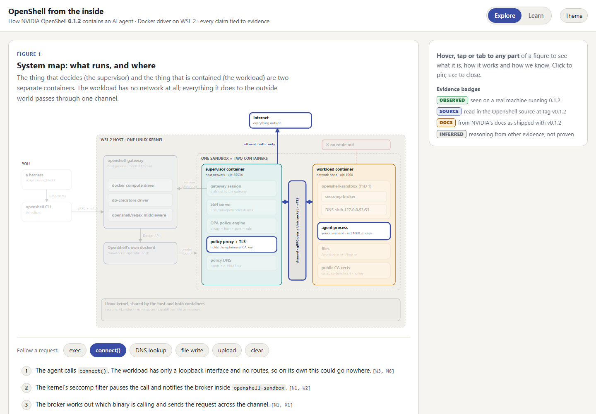

# OpenShell from the inside

An interactive architecture diagram and lesson on how [NVIDIA OpenShell](https://github.com/NVIDIA/OpenShell) contains an AI agent, and what that teaches about running agents safely. Every claim on the page is tied to evidence.



## Open it

Download or clone the repository and open `index.html` in a browser. It is one self-contained file with no dependencies and works offline.

- **Explore:** hover over, tap or tab to any part of a figure. A panel explains it in one plain sentence, then how it really works, then the evidence.
- **Learn:** nine short modules. Each asks you to predict first, then explore a figure, answer recall questions, run a command yourself, and take away one principle.

## What it covers

| | |
|---|---|
| Figure 1 | System map, with step-through paths for exec, `connect()`, DNS, file write and upload |
| Figure 2 | Which part of a policy file is enforced where, and which part can change live |
| Figure 3 | Twelve locks in four groups, and the one kernel they depend on |
| Figure 4 | The life of a `connect()` call, with its deny and allow endings |
| Figure 5 | Startup order, phases, and what happens when the supervisor disappears |
| Limits | What the sandbox does not protect you from |
| Simulator | Write network rules, send a request, see the verdict and the log line |

## Ground rules

- **Version:** OpenShell **0.1.2**, Docker driver, on WSL 2. Later versions may differ.
- **Evidence:** each claim is badged as observed on a real machine, read in the OpenShell source at tag `v0.1.2`, taken from the docs shipped with that tag, or inferred. The claims table is `tasks/doc_audit.md`: 100 rows, each with its source and status.
- **The simulator is a simplified model**, not OpenShell. It says what it leaves out.
- A few rows rest on notes from a private project and are marked `OBS-P`; those cannot be checked from this repository.
- This is an independent study project. It is not affiliated with or endorsed by NVIDIA.

## Repository layout

| Path | What it is |
|---|---|
| `index.html` | The page |
| `tasks/doc_audit.md` | Every claim, its evidence and its status |
| `tasks/todo.md` | The plan and the review of what was and was not verified |
| `evidence/inspect.sh`, `evidence/probe.py` | The read-only inspection that produced the observations |
| `evidence/policy_deny_all.yaml`, `evidence/policy_allow_example.yaml` | The two policies used |
| `evidence/runs/` | Raw output of the two live runs |
| `scripts/check_content.py` | Checks that every citation in the page points at a real audit row |
| `scripts/selftest.sh`, `scripts/phone.html` | Run the page's built-in self-test at desktop and phone width |

## Reproduce the observations

On a machine with OpenShell 0.1.2 and its Docker engine, in WSL:

```bash
env IMG=my-image:tag POLICY=evidence/policy_deny_all.yaml bash -l evidence/inspect.sh
env IMG=my-image:tag POLICY=evidence/policy_allow_example.yaml bash -l evidence/inspect.sh
```

`IMG` is any image in OpenShell's Docker engine that has `python3`; the allow example expects the interpreter at `/usr/local/bin/python3.12`. Each run creates one sandbox and deletes it at the end.

## Check the page

```bash
python scripts/check_content.py
scripts/selftest.sh        # needs Chrome; set CHROME=... if it is elsewhere
```
